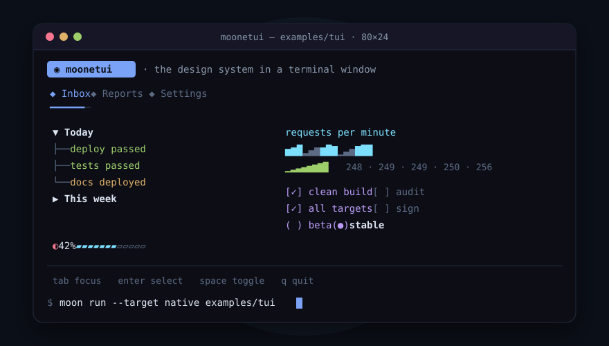

<div align="center">

# moonetui

**A terminal UI toolkit for [MoonBit](https://www.moonbitlang.com/)**

Cell buffer · differential ANSI renderer · incremental key parser · layout · CSS-like design system · widgets · pluggable terminal drivers

[](https://github.com/moonbitstack/moonetui/actions)
[](https://moonbitstack.github.io/moonetui/)
[](https://mooncakes.io/docs/#/moonbitstack/moonetui/)
[](LICENSE)

<p>

</p>

[Read the documentation](https://moonbitstack.github.io/moonetui/) · [Report an issue](https://github.com/moonbitstack/moonetui/issues)

</div>

## Highlights

| | |
|:--|:--|
| **Synchronous core** | No async, no hidden event loop. The host drives one `step()` — poll, parse, dispatch, lay out, compose, diff, write. |
| **Differential renderer** | Two frames become the spans that changed, and only the escape sequences needed to draw them. |
| **A CSS-like design system** | Selectors over name, id, class and `:focus` / `:hover` / `:disabled`, stacked by specificity and cascade, with inheritance, borders, padding, margins, docks, grid spans and transitions. |
| **Unicode-honest** | Every line is measured in terminal columns over a generated width table — wide CJK, double-width emoji, combining marks. Padding is never a guess. |
| **Four backends** | The same code and the same test suite on wasm, wasm-gc, js and native. |
| **Any wire** | A modern terminal with true colour, a serial-era terminal with the eight-colour palette, or a bare UART with no cursor addressing at all — the output degrades gracefully. |

## Quick start

```
moon add moonbitstack/moonetui
```

Three runnable examples of the same application:

```
moon run --target native examples/monitor  # a complete app: tabs, timers, a command line
moon run --target native examples/tui      # a styled TUI on a real terminal
moon run --target js examples/hello        # under Node
moon run --target native examples/gallery  # every widget, rendered one after another
moon run --target native examples/uart     # whole frames of text — a bare serial line
start examples/browser/index.html          # a canvas in a browser
```

Widgets are values. They render a line at a time and report through typed messages — no callbacks:

```moonbit
let button = @widget.Button::new(" Press me ")

let w : &@widget.Widget = button
let ctx = @widget.Ctx::new(1, @geom.Size::new(20, 3))
w.handle(ctx, @widget.Msg::Key(@event.Key::of(Enter)))
// ctx.asked() == [Pressed(id=1)]
```

<details>
<summary><b>A styled application, in brief</b></summary>

Compose widgets in a tree, hand the app a stylesheet, and drive the frame loop from a driver:

```moonbit
let sheet = @design.Stylesheet::new()
sheet.add(
  @design.Sel::new(name="Header"),
  @design.Styles::new(text=Some(@style.Style::new(bold=true, fg=@style.cyan))),
)
sheet.add(
  @design.Sel::new(classes=["framed"], focus=true),
  @design.Styles::new(border=Some(@design.Heavy)),
)

let tree = @app.column(0, [
  @app.leaf(1, @widget.Header::new("moonetui"), box=@layout.Box::new(extent=Cells(1))),
  @app.leaf(2, list, box=@layout.Box::new(extent=Frac(1))),
  @app.leaf(3, @widget.Footer::new([("tab", "next"), ("enter", "choose")]), box=@layout.Box::new(extent=Cells(1))),
])

let ui = @app.App::new(tty, tree, sheet~)
ui.start()
@node.pump(16, () => {
  let alive = ui.step() catch { _ => false }
  for report in ui.drain() { /* answer the widgets' messages */ }
  alive
})
```

A node the pointer rests on takes `:hover` styles, a disabled one takes `:disabled` and neither focus nor input, and a transition glides a node to wherever the next layout puts it.

</details>

## The widget inventory

| Group | Widgets |
|:--|:--|
| Text & display | `Static` / `label()`, `Header`, `Footer`, `Rule`, `Digits`, `Sparkline`, `Progress`, `LoadingIndicator`, `Placeholder` |
| Entry & logs | `Input`, `TextArea`, `Log`, `RichLog` |
| Choices | `Switch`, `Checkbox`, `RadioSet`, `OptionList`, `SelectionList`, `Select` |
| Navigation & structure | `Button`, `ListView`, `Tabs`, `TabbedContent`, `Collapsible`, `Tree`, `DirectoryTree` |
| Data & notices | `DataTable`, `Markdown`, `Tooltip`, `Toast` |

Thirty-two in all — every widget above ships complete, with its keyboard contract, message shape and tests.

## Standards

- **Unicode** — rendering is measured in terminal columns over a generated width table; alignment and padding hold for CJK, emoji and combining marks alike.
- **ECMA-48 / ISO 6429** — the control sequences emitted follow the international standard for control functions: SGR (`CSI … m`) for character attributes, CUP (`CSI H`) for cursor addressing, ED for erase. A terminal built to the standard renders moonetui output without negotiation.
- **UTF-8** — the input decoder is incremental, so a code point split across two reads arrives whole.

## Package map

| Package | What it does |
|:--|:--|
| `@geom` | Integer rectangle algebra: `Offset`, `Size`, `Region`, `Spacing` — intersection, union, splitting, clamping |
| `@style` | Colours (named, indexed, true colour), attributes, palette quantisation, differential SGR rendering |
| `@strip` | One rendered line: styled segments measured in terminal columns, with cropping, division, padding and merging |
| `@event` | Keys, mouse reports, paste, resize and focus as plain values |
| `@input` | The terminal byte stream turned into events: CSI and SS3 sequences, modifiers, SGR mouse, bracketed paste, in-band resize, split UTF-8 |
| `@comp` | The compositor: placements to composed rows, consecutive screens to changed spans, spans to escape sequences |
| `@driver` | The seam to a terminal — write, poll, size, raw mode, clock — plus a headless terminal for tests |
| `@layout` | Fixed, percentage, automatic and fractional sizes along an axis; the grid with spans and gutters — integer division that loses no column |
| `@design` | Rules over name, id, class and state, stacked by specificity and cascade; border, padding, margin, alignment, display, dock, offsets, transitions |
| `@widget` | The widget contract and twenty-eight widgets |
| `@app` | The widget tree, focus ring, scroll containers, edge docks, grids, stacked screens, timers, and the frame loop |
| `@driver/node` · `@driver/web` · `@driver/native` | Node's terminal; a canvas in the browser; a real terminal through the C library |

## Tests

```
moon check --target all --deny-warn
moon build --target all
moon test  --target all
moon fmt && moon info --target all     # the diff must stay clean
```

273 tests per backend (285 on js), the same suite on wasm, wasm-gc, js and native, run on Ubuntu, macOS and Windows in CI.

## License

Apache-2.0. See [LICENSE](LICENSE).
