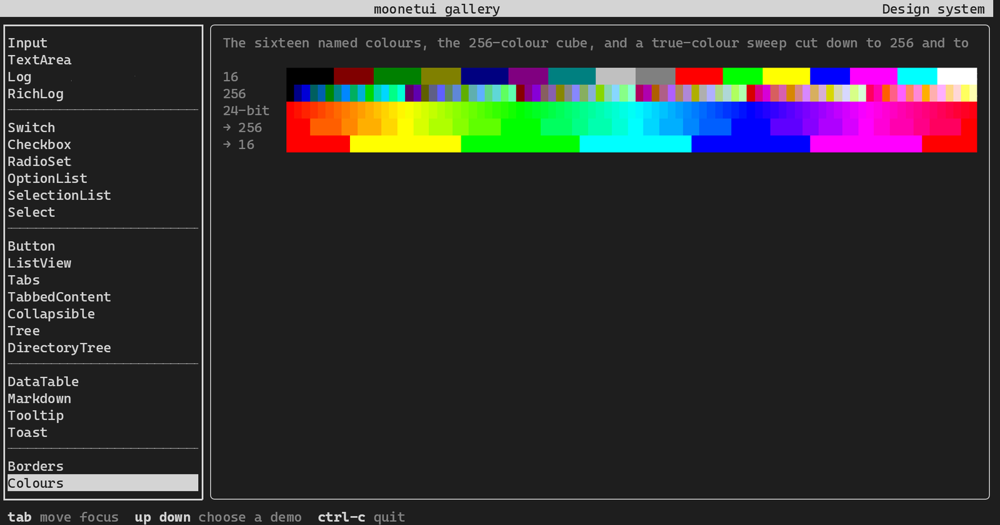

<div align="center">

# MoonBit Easy Terminal UI Frame

**`moonetui`** · a terminal UI toolkit for [MoonBit](https://www.moonbitlang.com/)

Cell buffer · differential ANSI renderer · incremental key parser · layout · CSS-like design system · fifty widgets · drivers for terminals, Node, browsers and serial lines

[](https://github.com/moonbitstack/moonetui/actions)
[](https://moonbitstack.github.io/moonetui/)
[](https://mooncakes.io/docs/#/moonbitstack/moonetui/)
[](LICENSE)

<p>

</p>

[Documentation, with every widget running live](https://moonbitstack.github.io/moonetui/) · [Report an issue](https://github.com/moonbitstack/moonetui/issues)

</div>

## Highlights

| | |
|:--|:--|
| **Synchronous core** | No async and no hidden event loop. The host calls one `step()`: poll, parse, dispatch, lay out, compose, diff, write. |
| **Differential renderer** | Two frames become the spans that changed, and only the escape sequences needed to draw them. |
| **A CSS-like design system** | Selectors over name, id, class and `:focus`, `:hover`, `:disabled`, stacked by specificity and cascade, with inheritance, borders, padding, margins, docks, grid spans and transitions. |
| **Unicode-aware** | Every line is measured in terminal columns over a generated width table: wide CJK, double-width emoji, combining marks. |
| **Four backends** | The same code and the same test suite on wasm, wasm-gc, js and native. |
| **Any wire** | A modern terminal with true colour, a serial-era terminal with eight colours, a browser canvas, or a bare UART with no cursor addressing at all. |

## Quick start

```
moon add moonbitstack/moonetui
```

```
moon run --target native src/examples/gallery   # every widget and every style, live
moon run --target native src/examples/monitor   # a complete app: tabs, timers, a command line
moon run --target native src/examples/tui       # a styled app in a real terminal
moon run --target js src/examples/hello         # under Node
moon run --target native src/examples/uart      # whole frames of plain text, as a serial line gets them
```

The gallery runs in a browser too: `moon build --target js`, serve the repository root, and open `src/examples/browser/index.html`.

A first application: a list, a field, and a stylesheet that frames the list and thickens the frame while it has focus.

```moonbit
fn main raise {
  let sheet = @design.Stylesheet::new()
  sheet.add(
    @design.Sel::new(name="Header"),
    @design.Styles::new(text=@style.Style::new(bold=true, fg=@style.cyan)),
  )
  sheet.add(@design.Sel::new(classes=["framed"]), @design.Styles::new(border=Round))
  sheet.add(
    @design.Sel::new(classes=["framed"], focus=true),
    @design.Styles::new(border=Heavy),
  )
  let list = @widget.ListView::new(["alpha", "beta", "gamma"])
  let field = @widget.Input::new(placeholder="pick one")
  let line = @layout.Box::new(extent=Cells(1))
  let tree = @app.column(0, [
    @app.leaf(1, @widget.Header::new("moonetui"), box=line, name="Header"),
    @app.leaf(2, list, classes=["framed"]),
    @app.leaf(3, field, box=line),
    @app.leaf(4, @widget.Footer::new([("tab", "next"), ("enter", "choose")]), box=line),
  ])
  let ui = @app.App::new(@native.NativeTty::new(), tree, sheet~)
  ui.start()
  @native.run(() => {
    let alive = ui.step()
    for report in ui.drain() {
      if report is Selected(index~, ..) {
        field.set(list.items()[index])
        ui.refresh()
      }
    }
    alive
  })
  ui.stop()
}
```

Its `moon.pkg` imports `app`, `design`, `driver/native`, `layout`, `style` and `widget` from `moonbitstack/moonetui`, and declares `supported_targets = "native"`.

## The widget inventory

| Group | Widgets |
|:--|:--|
| Text and display | `Static` and `label()`, `Header` (with a `Clock`), `Footer`, `Rule`, `Digits`, `Sparkline`, `Progress`, `LoadingIndicator`, `Placeholder`, `Pretty`, `Link` |
| Entry and logs | `Input`, `TextArea`, `Log`, `RichLog`, `MaskedInput` |
| Choices | `Switch`, `Checkbox`, `RadioButton`, `RadioSet`, `OptionList`, `SelectionList`, `Select` |
| Navigation and structure | `Button`, `ListView`, `Tabs`, `TabbedContent`, `Collapsible`, `Tree`, `DirectoryTree`, `ContentSwitcher`, `StatefulList`, `StatefulTable` |
| Data and notices | `DataTable`, `Markdown`, `Tooltip`, `Toast` |
| Dialogs | `MessageBox`, `InputBox`, `FileDialog` |
| Menus and commands | `Menu`, `MenuBar`, `CommandPalette` |
| Charts and meters | `Chart` (lines and scatter), `BarChart`, `Gauge`, `Scrollbar` |
| Decoration | `Block` — a frame, title and padding that wraps any widget |

Each one has its keyboard contract, message shape and tests, and a live demo on the [documentation site](https://moonbitstack.github.io/moonetui/#/widgets) beside its source.

### What 0.4.0 adds

Prefabricated dialogs (`MessageBox`, `InputBox`, `FileDialog`), a `MenuBar` with drop-down
`Menu`s and a `CommandPalette`, anchored and pivoted layout, the `Block` decorator, state-outside
widgets (`StatefulList`, `StatefulTable`) that share selection and scroll with the caller, charts
and meters (`Chart`, `BarChart`, `Gauge`, `Scrollbar`), a semantic colour `Theme` that swaps as a
value object, and the remaining controls: `ContentSwitcher`, `Pretty`, `MaskedInput`, `Link` and
a `Clock` for the `Header`. Every new control has headless snapshot tests with a keyboard and a
mouse example.

## Package map

| Package | What it does |
|:--|:--|
| `@geom` | Integer rectangle algebra: `Offset`, `Size`, `Region`, `Spacing` |
| `@style` | Colours (named, indexed, true colour), attributes, palette quantisation, differential SGR |
| `@strip` | One rendered line: styled segments measured in terminal columns |
| `@event` | Keys, mouse reports, paste, resize and focus as plain values |
| `@input` | The terminal byte stream turned into events |
| `@comp` | The compositor: placements to rows, rows to changed spans, spans to escape sequences |
| `@driver` | The seam to a terminal, and a headless terminal for tests |
| `@vt` | A virtual terminal: the screen an escape stream draws, for the browser driver, tests and screenshots |
| `@layout` | Sizes along an axis, the grid with spans and gutters, and anchored, pivoted placement |
| `@design` | Rules over name, id, class and state; borders, padding, margins, alignment, docks, offsets, transitions, and the semantic `Theme` |
| `@widget` | The widget contract and the inventory |
| `@app` | The widget tree, focus ring, scroll containers, docks, grids, screens, timers and the frame loop |
| `@driver/native` · `@driver/node` · `@driver/web` | A real terminal through the C library; Node; a canvas in the browser |

## Standards

- **Unicode**: rendering is measured in terminal columns over a generated width table.
- **ECMA-48 / ISO 6429**: SGR (`CSI … m`) for attributes, CUP (`CSI H`) for addressing, ED and EL for erasing.
- **UTF-8**: the input decoder is incremental, so a code point split across two reads arrives whole.

## Tests

```
moon check --target all --deny-warn
moon build --target all
moon test  --target all
moon fmt && moon info --target all     # the diff must stay clean
```

599 tests per backend, the same suite on wasm, wasm-gc, js and native, run on Ubuntu, macOS and Windows in CI. They cover 91% of the lines.

## Licence

Apache-2.0. See [LICENSE](LICENSE).
